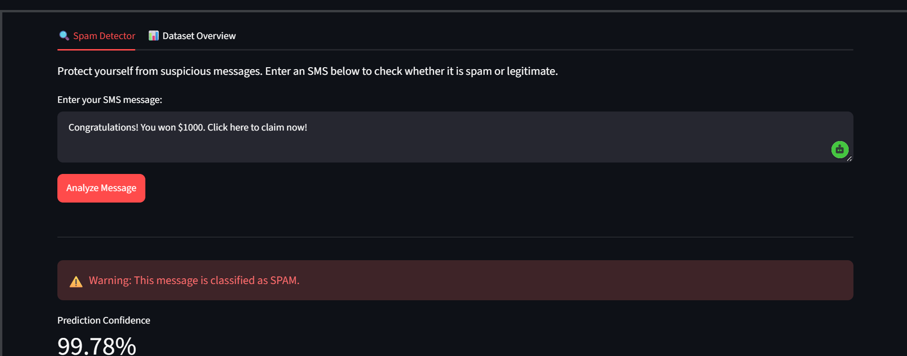
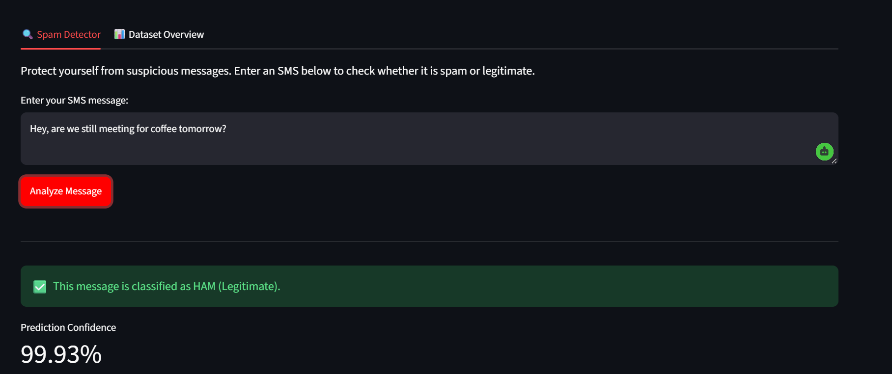
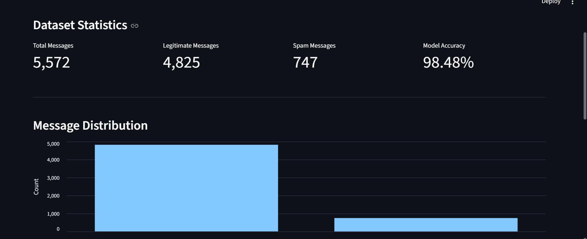

# 🛡️ MessageShield

**AI-Powered SMS Spam Detection System**

MessageShield is a machine learning-based spam detection system that classifies SMS messages as spam or legitimate using Natural Language Processing and Naive Bayes classification.


## 🎯 Live Demo

### Spam Detection

*MessageShield correctly identifying a spam message with 99.6% confidence*

### Legitimate Message Classification

*Legitimate message classified as HAM with 99.9% confidence*

### Dataset Dashboard

*Interactive dashboard showing dataset statistics and model performance metrics*

## ✨ Features

- **High Accuracy**: 98.48% accuracy with 91% spam detection rate
- **Interactive Web Interface**: User-friendly Streamlit dashboard
- **Real-time Detection**: Instant spam classification with confidence scores
- **Multiple Interfaces**: Web app, CLI, and Python API
- **Dataset Visualization**: Interactive charts and statistics
- **Advanced NLP**: TF-IDF vectorization with bigrams and stop word removal

## 📊 Model Performance

| Metric | Value |
|--------|-------|
| **Accuracy** | 98.48% |
| **Spam Detection Rate** | 91% |
| **Precision (Spam)** | 98% |
| **Recall (Spam)** | 91% |
| **False Positives** | 3 out of 1,115 |
| **False Negatives** | 14 out of 1,115 |

## 🚀 Quick Start

### Prerequisites

- Python 3.8 or higher
- pip package manager

### Installation

1. Clone the repository:
```bash
git clone https://github.com/k-deejah/MessageShield.git
cd MessageShield
```

2. Install dependencies:
```bash
pip install -r requirements.txt
```

3. Train the model (optional - pre-trained model included):
```bash
python src/train_improved.py
```

## 💻 Usage

### Web Interface (Recommended)

Launch the interactive web app:
```bash
python -m streamlit run app.py
```

Or on Windows, double-click `run_app.bat`

The app will open at `http://localhost:8501`

**Features:**
- Enter any SMS message to check if it's spam
- View confidence scores and probabilities
- Explore dataset statistics and model performance metrics

### Command Line Interface

Check a single message:
```bash
python src/classify.py "Your message here"
```

**Examples:**
```bash
# Spam message
python src/classify.py "Congratulations! You won $1000. Click here now!"

# Legitimate message
python src/classify.py "Hey, are we still meeting for coffee tomorrow?"
```

### Interactive CLI

For multiple message checks in one session:
```bash
python src/check_message.py
```

Type messages one at a time, and type `quit` to exit.

### Python API

Use the model in your own Python scripts:
```python
import joblib
from pathlib import Path

# Load the model
model = joblib.load("models/spam_model.pkl")
vectorizer = joblib.load("models/tfidf_vectorizer.pkl")

# Classify a message
message = "Free entry to win cash prizes!"
message_vector = vectorizer.transform([message])
prediction = model.predict(message_vector)[0]
probabilities = model.predict_proba(message_vector)[0]

print(f"Prediction: {prediction}")
print(f"Spam probability: {probabilities[1]*100:.2f}%")
```

## 📁 Project Structure

```
MessageShield/
├── app.py                      # Streamlit web application
├── data/
│   └── SMSSpamCollection      # Dataset (5,572 messages)
├── models/
│   ├── spam_model.pkl         # Trained Naive Bayes model
│   └── tfidf_vectorizer.pkl   # TF-IDF vectorizer
├── src/
│   ├── main.py                # Original training script
│   ├── train_improved.py      # Improved model training
│   ├── classify.py            # CLI message classifier
│   ├── check_message.py       # Interactive checker
│   └── predict.py             # Batch prediction script
├── screenshots/               # Application screenshots
├── requirements.txt           # Python dependencies
├── run_app.bat               # Windows launcher
├── LICENSE                   # MIT License
├── CONTRIBUTING.md           # Contribution guidelines
├── CODE_OF_CONDUCT.md        # Community standards
└── README.md                 # This file
```

## 🧠 Technical Details

### Model Architecture

- **Algorithm**: Multinomial Naive Bayes
- **Vectorization**: TF-IDF (Term Frequency-Inverse Document Frequency)
- **Features**: 5,000 most important features
- **N-grams**: Unigrams and Bigrams (1-2 word phrases)
- **Preprocessing**: Lowercase conversion, English stop words removal
- **Alpha Parameter**: 0.1 (tuned for increased sensitivity)

### Dataset

- **Source**: [SMS Spam Collection Dataset](https://archive.ics.uci.edu/ml/datasets/sms+spam+collection)
- **Total Messages**: 5,572
  - Legitimate (Ham): 4,825 (86.6%)
  - Spam: 747 (13.4%)
- **Training Set**: 4,457 messages (80%)
- **Test Set**: 1,115 messages (20%)
- **Split Method**: Stratified to maintain class distribution

### Key Improvements Over Basic Models

1. **Bigram Analysis**: Captures multi-word phrases like "click here", "free prize", "win now"
2. **Stop Word Removal**: Filters common English words to focus on meaningful content
3. **Optimized Alpha**: Lower alpha (0.1) increases model sensitivity to spam indicators
4. **Feature Selection**: 5,000 carefully selected features for optimal balance
5. **TF-IDF Weighting**: Prioritizes rare, distinctive words over common ones

### Why Naive Bayes?

- **Fast Training & Prediction**: Ideal for real-time applications
- **Low Resource Requirements**: Works well even with limited data
- **Probabilistic Output**: Provides confidence scores, not just binary classification
- **Proven Effectiveness**: Industry standard for text classification tasks

## 📈 Example Predictions

| Message | Prediction | Confidence |
|---------|-----------|------------|
| "Congratulations! You won $1000" | SPAM | 99.6% |
| "Hey, click this link you win 400$" | SPAM | 85.4% |
| "FREE entry to win cash prizes!" | SPAM | 99.6% |
| "Hey, are we meeting tomorrow?" | HAM | 99.9% |
| "Thanks for dinner last night!" | HAM | 98.3% |

## 🛠️ Development

### Training a New Model

To retrain the model with custom parameters:

```bash
python src/train_improved.py
```

This script will:
1. Load the SMS Spam Collection dataset
2. Preprocess and vectorize the text using TF-IDF
3. Train the Multinomial Naive Bayes classifier
4. Evaluate performance on the test set
5. Save the trained model and vectorizer to `models/`

### Running Tests

Test the model with predefined sample messages:
```bash
python src/predict.py
```

## 🔮 Future Enhancements

- [ ] Deep Learning models (LSTM, BERT) for improved accuracy
- [ ] Multi-language spam detection support
- [ ] REST API endpoint for integration with other applications
- [ ] Mobile app (iOS/Android)
- [ ] Email spam detection extension
- [ ] Real-time learning from user feedback
- [ ] Explainable AI features (highlight spam indicators)
- [ ] Batch processing for large message datasets

## 🤝 Contributing

Contributions are welcome! Please read [CONTRIBUTING.md](CONTRIBUTING.md) for details on our code of conduct and the process for submitting pull requests.

### Quick Contribution Guide

1. **Fork the repository**
2. **Create a feature branch**: `git checkout -b feature/AmazingFeature`
3. **Make your changes and commit**: `git commit -m 'Add some AmazingFeature'`
4. **Push to your branch**: `git push origin feature/AmazingFeature`
5. **Open a Pull Request**

## 📄 License

This project is licensed under the MIT License - see the [LICENSE](LICENSE) file for details.

## 🙏 Acknowledgments

- [SMS Spam Collection Dataset](https://archive.ics.uci.edu/ml/datasets/sms+spam+collection) from UCI Machine Learning Repository
- [Scikit-learn](https://scikit-learn.org/) for comprehensive machine learning tools
- [Streamlit](https://streamlit.io/) for the intuitive web framework
- The open-source community for inspiration and support

## 📧 Contact & Support

- **GitHub**: [@k-deejah](https://github.com/k-deejah)
- **Repository**: [MessageShield](https://github.com/k-deejah/MessageShield)
- **Issues**: [Report a bug or request a feature](https://github.com/k-deejah/MessageShield/issues)

## 🌟 Show Your Support

If you find this project helpful, please consider:
- ⭐ Starring the repository
- 🔄 Sharing with others
- 🐛 Reporting bugs
- 💡 Suggesting new features
- 🤝 Contributing code

---

**Built with ❤️ by [@k-deejah](https://github.com/k-deejah)**